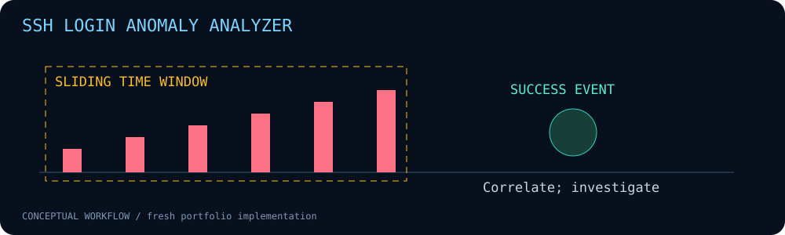

# SSH Login Anomaly Analyzer



Offline correlation of SSH failed-login bursts and subsequent successful authentication.

**Fresh portfolio implementation • Python 3.10+ • Standard library only**

## Run

```bash
python3 --version
python3 analyzer.py examples/auth.log --threshold 5 --window 300
python3 -m unittest discover -s tests -v
```

## Implemented behavior

- Parses sshd password failures and accepted password/publickey events with timezone-aware ISO 8601 timestamps.
- Sorts out-of-order events and uses a per-destination-host/source-IP sliding window; one burst alert per contiguous threshold episode.
- Reports successful authentication after a threshold of failures from the same IP on the same destination host; every finding includes `host`.
- Explicit ignored-line and parsed-event counts expose coverage gaps.

Host names are matched exactly as logged. Normalize host aliases upstream if needed. Missing host fields and SSH-looking text embedded in another application's message are ignored. This is per-host correlation, not detection of campaigns spread across hosts.

## Scope and limitations

Only `TIMESTAMP HOST sshd[PID]: MESSAGE` (or `sshd:` without a PID) text with an ISO 8601 timestamp is accepted (for example rsyslog RFC3339-style output); classic `Oct 12 12:00:00` logs are ignored, not assigned an invented year/timezone. Duplicates count; deduplicate upstream when necessary. Same IP does not prove same user or actor; NAT and automation cause false positives. Input capped at 20 MiB. Ties use source line order. Logs may contain personal data; only synthetic documentation-range addresses are shipped. No blocking or live journald collection.

## Validation

12 unit tests passed locally on Python 3.12.14. Synthetic CLI examples were executed and results are included under `examples/`. No customer data, historical lab results or production effectiveness is claimed. CI configuration is supplied; remote CI status must be checked after publishing.

## Files

- `analyzer.py` — implementation and CLI.
- `tests/test_main.py` — regression and boundary tests.
- `examples/` — synthetic inputs and generated output.
- `assets/workflow.svg` — project-specific animation with reduced-motion support.
- `.github/workflows/ci.yml` — pinned-action CI.

## Safe operation

Use inputs and hosts you own or are authorized to assess. Review reports before publication; real files, headers and logs can contain sensitive information. These tools do not establish that a system is secure or compromised.

